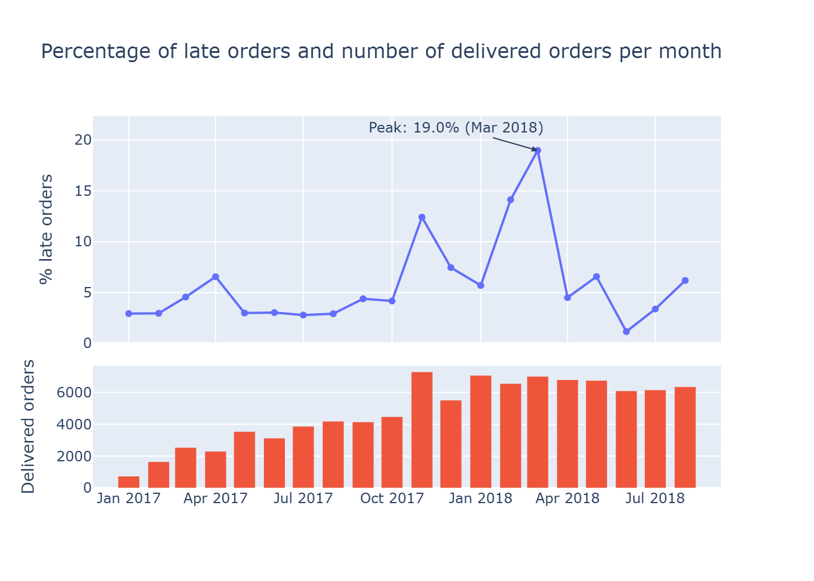
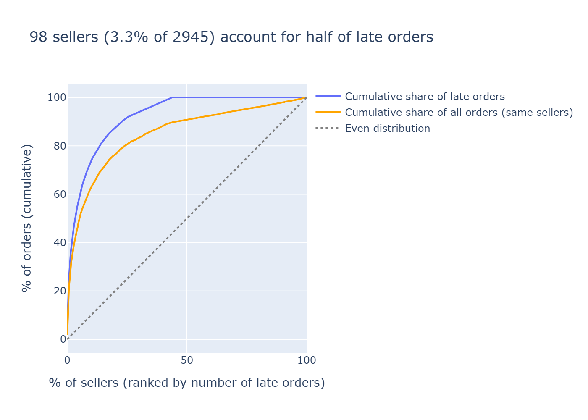

# Late Deliveries vs. Customer Satisfaction: Olist E-Commerce

SQL analysis of the [Olist Brazilian E-Commerce dataset](https://www.kaggle.com/datasets/olistbr/brazilian-ecommerce) with DuckDB, built around one question:

> **Where and why do late deliveries hurt customer satisfaction, and which states or sellers should be targeted first?**

<!-- TODO: one-paragraph headline result, e.g. "Orders delivered 8+ days late score X points lower than on-time ones; N sellers account for P% of late orders." -->

**Stack:** DuckDB (SQL) · pandas · plotly · Jupyter

---

## Key findings

<!-- TODO: fill with real numbers once the queries are final. Delete this comment and the placeholders below. -->

1. **Late deliveries are 6.8% of orders**, with peaks in March and February 2018.
   
2. **Delay lowers satisfaction.** Average review score goes from 4.3 (on time) to 1.7 (8+ days late); 70% of 8+ day late orders get 1 or 2 stars.
   
3. **Geography.** AL and MA are both the top 2 states with most late orders and the top 2 states with lowest average review score.
   
4. **Concentration.** 11% sellers account for 42% of late orders: where an intervention pays off first.
   
5. **Not a category artifact.** The score drop holds in all the categories with enough volume.
   

## Dataset

Public Olist dataset (orders from ~2016 to 2018, ~100k orders). **The CSV files are not included in this repository**: download them from [Kaggle](https://www.kaggle.com/datasets/olistbr/brazilian-ecommerce) (see the dataset page for license terms) and place them in `data/`.

Tables used: `customers`, `orders`, `order_items`, `order_payments`, `order_reviews`, `products`, `sellers`, `product_category_name_translation`. The geolocation table is not used.

## Methodology and decisions

| Topic | Decision | Rationale |
|---|---|---|
| Analysis window | Orders purchased between 2017-01-01 and 2018-08-31 | months outside this range are sparse (see check J in `q01`) |
| Order status | Excluded `canceled` and `unavailable`; delivery metrics use `delivered` orders only | **TODO** |
| Grain | One row per order (seller analysis: one row per order × seller) | Joining `order_items` to order-level views multiplies rows and biases rates and averages |
| Revenue | `SUM(price)`, freight excluded | Revenue generated by products, independent of shipping fees |
| Late definition | `is_late` and `days_late` defined consistently in `v_delivery` | Late = delivered after the estimated delivery date |
| Reviews | Latest review per order (`v_reviews`) | Some orders have more than one review |
| State dimension | customer state | More actionable than seller state |
| Minimum sample | threshold of minimum 30 orders per group | Avoids ranking on noise |

All filters live in one place (`v_orders_scope`) and every query reuses it.

## Data quality

`q01_quality_checks.sql` covers orphan orders and items, duplicated reviews and payments, order status distribution, delivered orders with missing delivery date, untranslated categories and monthly order volume.

<!-- TODO: summarize the results, e.g. "N orders without items, all `canceled` or `unavailable`; N orders with more than one review (kept the latest)." -->

<!-- TODO: ## How to run -->
`01_staging.sql` is exploratory (schema and key checks) and not required to reproduce the results.

<!-- TODO: replace the steps above with a single run_all script if you add one. -->

## Limitations

- **Association, not causation.** Late deliveries correlate with other problems (stock-outs, distance, product type). Category stratification (`q08`) reduces but does not remove confounding.
- **Self-selection.** Satisfaction is measured only on customers who left a review.
- **Delivered orders only.** Orders still in transit or never delivered are excluded from delivery metrics, which can bias results toward faster outcomes.
- **"Late" is relative to a promise.** The estimated delivery date is set by the marketplace at purchase time; it measures missed expectations, not absolute speed.
- **Multi-seller and multi-category orders** appear in more than one group in seller and category views.
- **Small groups.** States, sellers and categories below the minimum sample are excluded; ranks of small groups are noisy.

## Next steps

<!-- TODO: e.g. confidence intervals on score differences, regression controlling for delivery time, order value and number of items, review text analysis. -->
