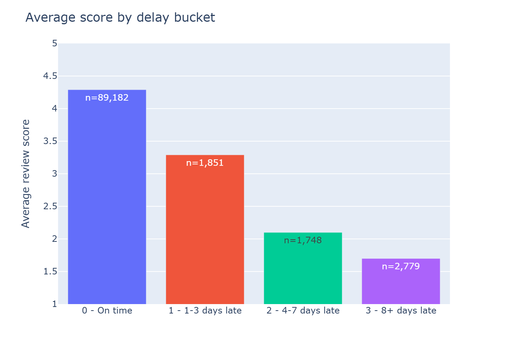
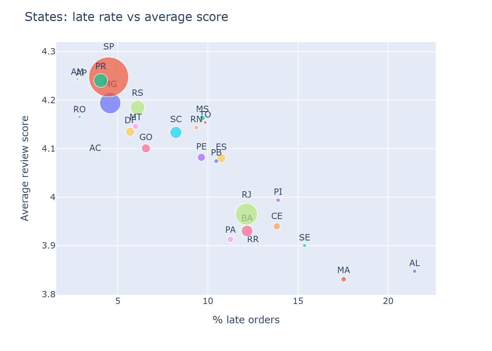
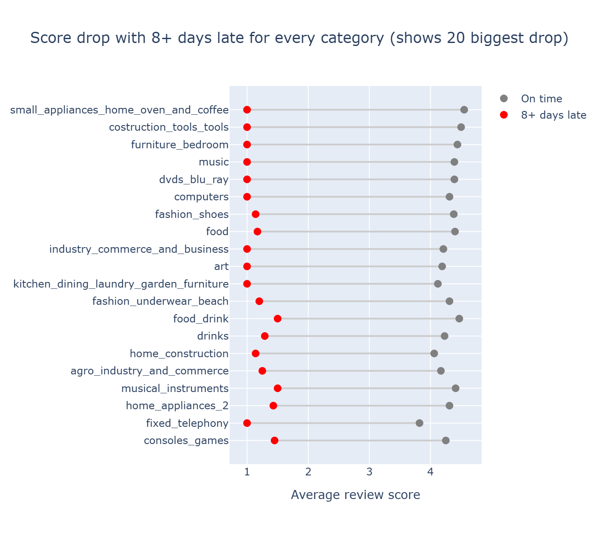

# Late Deliveries vs. Customer Satisfaction: Olist E-Commerce

SQL analysis of the [Olist Brazilian E-Commerce dataset](https://www.kaggle.com/datasets/olistbr/brazilian-ecommerce) with DuckDB, built around one question:

> **Where and how do late deliveries hurt customer satisfaction, and which states or sellers should be targeted first?**

Of the 96,203 delivered orders purchased between January 2017 and August 2018, 6.8% arrived late. Orders delivered 8+ days late score 1.7 on average against 4.29 for on-time ones, and 70% of them get a 1-star review. Late rates are highest in AL and MA, which are also the states with the lowest scores. The 50 sellers with the most late orders account for 38% of all late orders.

**Stack:** DuckDB (SQL) · pandas · plotly · Jupyter

---

## Key findings

All numbers come from [`sql/04_headlines.sql`](sql/04_headlines.sql) and the notebook (`report.ipynb`); rates are on delivered orders.

1. **Late deliveries are 6.8% of orders**, with the worst months in March 2018 (19.0%), February 2018 (14.1%) and November 2017 (12.4%, a volume spike: 7,544 orders against 4,631 in October).
   
2. **Late deliveries get much worse reviews.** The average score goes from 4.29 (on time) to 1.70 (8+ days late); 70% of the 8+ day late orders get 1 star and 79% get 1 or 2 stars.
   
3. **Geography.** AL (21.5% late) and MA (17.5%) have the highest late rates and also the lowest average review scores (MA 3.83, AL 3.85), among states with at least 30 orders.
   
4. **Concentration.** The top 10% of sellers by number of late orders account for 74% of late orders (87% for the top 20%). Seller volume is concentrated too, so this shows where an intervention moves the most orders, not that these sellers are worse: the chart compares with the share of all orders of the same sellers, and the ranking table shows late *rates* for sellers with at least 30 orders.
   
5. **Not a category artifact.** The score is lower with 8+ days late than on time in 20 out of 20 categories with enough volume (at least 30 reviewed orders in both groups).
   

## Dataset

Public Olist dataset (orders from 2016 to 2018, ~100k orders). **The CSV files are not included in this repository**: download them from [Kaggle](https://www.kaggle.com/datasets/olistbr/brazilian-ecommerce) (see the dataset page for license terms) and place them in `data/`.

Tables used: `customers`, `orders`, `order_items`, `order_payments`, `order_reviews`, `products`, `sellers`, `product_category_name_translation`. The geolocation table is not used. Columns and keys are in the [data dictionary](docs/data_dictionary.md).

## Repository structure

```
data/                  Kaggle CSVs (not in the repo)
sql/
  00_load.sql          CSV -> DuckDB tables
  01_staging.sql       exploratory: schemas and key checks
  02_views.sql         v_orders_scope, v_order_revenues, v_delivery, v_reviews, v_order_sellers
  03_quality_checks.sql, 05_extra_checks.sql   data quality checks
  04_headlines.sql     headline numbers for this README
  q00 to q06           queries behind the charts (summary, monthly, score by delay, states, sellers, categories)
  extra_01 to extra_05 extra analyses and sensitivity checks (not in the notebook)
docs/                  data_dictionary.md, data_quality.md
img/                   charts exported by the notebook
build_db.py            builds olist.duckdb
report.ipynb           runs the queries and draws the charts
```

## How to run

```bash
python -m venv .venv && source .venv/bin/activate    # Windows: .venv\Scripts\activate
pip install -r requirements.txt
# put the Kaggle CSVs in data/
python build_db.py        # builds olist.duckdb (the notebook does the same on start)
jupyter lab report.ipynb  # run all cells: results in the notebook, charts in img/
```

PNG export uses kaleido, which needs Chrome: if a cell prints "PNG export skipped", run `plotly_get_chrome` once.

## Methodology and decisions

| Topic | Decision | Rationale |
|---|---|---|
| Analysis window | Orders purchased between 2017-01-01 and 2018-08-31 | Months outside this range are sparse or incomplete (see check J in [data quality](docs/data_quality.md)) |
| Order status | Excluded `canceled` and `unavailable`; delivery metrics use `delivered` orders with a delivery date | Orders never delivered have no delivery outcome, and canceled or unavailable orders are not revenue |
| Grain | One row per order (seller analysis: one row per order × seller; category analysis: one row per order × category) | Joining `order_items` to order-level views multiplies rows and biases rates and averages |
| Revenue | `SUM(price)`, freight excluded | Revenue generated by products, independent of shipping fees |
| Late definition | `is_late` = delivered on a later calendar day than the estimated delivery date (`days_late > 0`); delay buckets defined once in `v_delivery` | A delivery during the estimated day is on time; one definition avoids drift between queries |
| Reviews | Latest review per order by answer timestamp (`v_reviews`) | Some orders have more than one review |
| State dimension | Customer state | An order has one customer state (and possibly several sellers), and the delay is experienced at the customer's end |
| Minimum sample | At least 30 orders for any ranked group (months, states, sellers); categories need 30 reviewed orders in both groups | Avoids ranking on noise |

All filters live in one place (`v_orders_scope`) and every query reuses it.

## Data quality

[`03_quality_checks.sql`](sql/03_quality_checks.sql) and [`05_extra_checks.sql`](sql/05_extra_checks.sql) cover orphan orders and items, duplicated reviews and payments, order status distribution, delivered orders with missing delivery date, untranslated categories, impossible timestamps and monthly order volume. In short:

- 775 orders have no items (767 are canceled or unavailable); they have no revenue by construction.
- 547 orders have more than one review (the latest is kept) and 2,961 have more than one payment (revenue uses item prices, not payments).
- 8 `delivered` orders have no delivery date and are excluded from delivery metrics.
- 4.9% of the reviews in scope were answered before the recorded delivery date (see Limitations).
- The date window keeps 99.6% of the orders; 99.3% of the delivered orders in scope have a review.

Findings, decisions and open questions are in [docs/data_quality.md](docs/data_quality.md).

## Limitations

- **Association, not causation.** Late deliveries correlate with other problems (stock-outs, distance, product type). Category stratification (`q06`) reduces but does not remove confounding.
- **Self-selection.** Satisfaction is measured only on orders with a review: 99.3% of delivered orders in scope, so the selection is small, but reviewers are still the customers who answered the survey.
- **Delivered orders only.** Orders still in transit or never delivered are excluded from delivery metrics, which can bias results toward faster outcomes, especially in the last months.
- **"Late" is relative to a promise.** The estimated delivery date is set by the marketplace at purchase time; it measures missed expectations, not absolute speed.
- **Reviews before delivery.** 4.9% of the reviews in scope were answered before the recorded delivery date; `extra_05_reviews_before_delivery.sql` shows the score by delay bucket with and without them.
- **Concentration reflects volume.** Sellers with more orders have more late orders; the seller chart shows the share of orders next to the share of late orders.
- **Multi-seller and multi-category orders** appear in more than one group in the seller and category views.
- **Small groups.** States, sellers and categories below the minimum sample are excluded from rankings; ranks of small groups are noisy.

## Next steps

- Confidence intervals (for example bootstrap) on the score differences between delay buckets.
- A regression of the review score on days late, controlling for delivery time, order value, number of items and state.
- Text analysis of review comments to separate delay complaints from product complaints.
