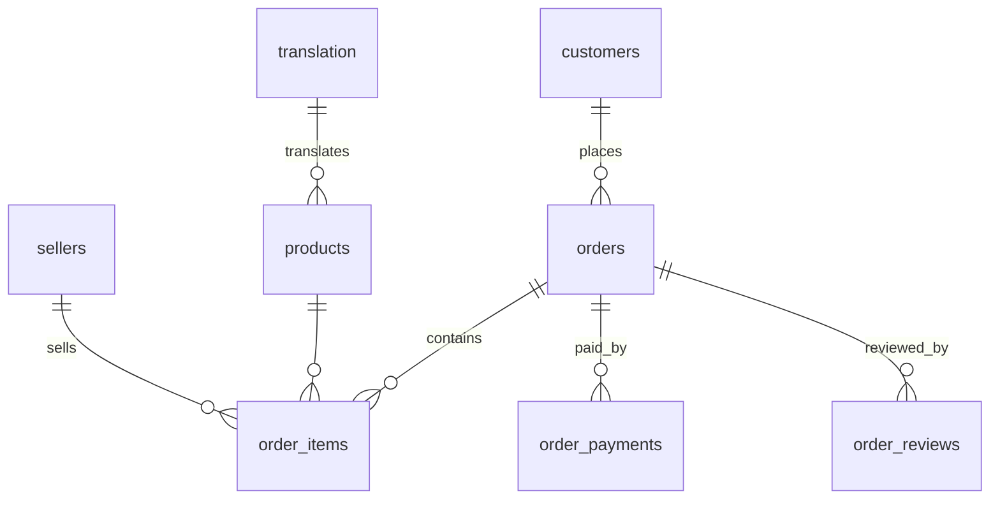

# Data dictionary: Olist E-Commerce

Reference for the tables, keys and derived views used in this project. Data quality findings and cleaning decisions are in [data_quality.md](data_quality.md).

## Source

- **Dataset:** [Brazilian E-Commerce Public Dataset by Olist](https://www.kaggle.com/datasets/olistbr/brazilian-ecommerce) (Kaggle). See the dataset page for license terms.
- **Downloaded on:** 24/10/2026
- **Period covered:** 2016-09-04 to 2018-10-17 (first and last order purchase timestamps).
- **Timestamps** carry no timezone information. **Currency** is Brazilian real (BRL).
- **Loaded with** [`00_load.sql`](../sql/00_load.sql) (`read_csv_auto`) into DuckDB; the column types below are the inferred ones.

## Overview

| Table | Description | Rows | Grain | Key | Used in |
|---|---|---:|---|---|---|
| `orders` | Orders and their lifecycle timestamps | 99,441 | one row per order | `order_id` | all queries |
| `order_items` | Products purchased in each order | 112,650 | one row per item in an order | `order_id`, `order_item_id` | revenue, categories, sellers |
| `customers` | Customer records | 99,441 | one row per `customer_id` (generated per order) | `customer_id` | state of delivery |
| `products` | Product catalog | 32,951 | one row per product | `product_id` | categories |
| `sellers` | Seller records | 3,095 | one row per seller | `seller_id` | seller analysis |
| `order_payments` | Payments for each order | 103,886 | one row per payment of an order | `order_id`, `payment_sequential` | `v_order_revenues` (`paid`) |
| `order_reviews` | Customer satisfaction reviews | 99,224 | one row per review; **no clean key** (see [data_quality.md](data_quality.md)) | none | `v_reviews` |
| `translation` | Category name translation, Portuguese to English | 71 | one row per category | `product_category_name` | categories |
| `geolocation` | Zip code prefixes with coordinates and city | 1,000,163 | one row per coordinate record | none | **not loaded, not used** |

The CSV for `translation` is named `product_category_name_translation.csv`; the table is created as `translation`.

Keys confirmed with checks K01 to K08 of [`05_extra_checks.sql`](../sql/05_extra_checks.sql): rows equal distinct key values in every table except `order_reviews` (99,224 rows, 98,410 distinct `review_id`, 98,673 distinct `order_id`).

## Relationships

- `orders` to `order_items` is **zero or more**: some orders have no items (check A in [data_quality.md](data_quality.md)).
- `customer_id` is generated per order, so `customers` and `orders` both have 99,441 rows. A person is identified by `customer_unique_id`, which repeats across orders (96,096 distinct values, check K03).
- A seller is reached only through `order_items`; an order can contain items from more than one seller (check K in [data_quality.md](data_quality.md)).

## Tables

### orders

| Column | Type | Description |
|---|---|---|
| `order_id` | VARCHAR | Order identifier (key) |
| `customer_id` | VARCHAR | Reference to `customers`; one per order |
| `order_status` | VARCHAR | Order status (distribution in [data_quality.md](data_quality.md)) |
| `order_purchase_timestamp` | TIMESTAMP | Purchase time |
| `order_approved_at` | TIMESTAMP | Payment approval time |
| `order_delivered_carrier_date` | TIMESTAMP | Time the order was handed to the carrier |
| `order_delivered_customer_date` | TIMESTAMP | Actual delivery time; NULL when not delivered |
| `order_estimated_delivery_date` | TIMESTAMP | Estimated delivery date communicated at purchase |

The estimated delivery date always has a 00:00:00 time part (check E1: 0 exceptions), so `days_late` compares calendar dates.

### order_items

| Column | Type | Description |
|---|---|---|
| `order_id` | VARCHAR | Reference to `orders` |
| `order_item_id` | BIGINT | Sequential number of the item within the order |
| `product_id` | VARCHAR | Reference to `products` |
| `seller_id` | VARCHAR | Reference to `sellers` |
| `shipping_limit_date` | TIMESTAMP | Deadline for the seller to hand the item to the carrier |
| `price` | DOUBLE | Item price |
| `freight_value` | DOUBLE | Freight cost of the item; split across items in multi-item orders |

### customers

| Column | Type | Description |
|---|---|---|
| `customer_id` | VARCHAR | Key; generated per order, **not** a person identifier |
| `customer_unique_id` | VARCHAR | Person identifier; repeats across orders of the same customer |
| `customer_zip_code_prefix` | VARCHAR | Zip code prefix |
| `customer_city` | VARCHAR | City |
| `customer_state` | VARCHAR | State (Brazilian UF code) |

### products

| Column | Type | Description |
|---|---|---|
| `product_id` | VARCHAR | Key |
| `product_category_name` | VARCHAR | Category name in Portuguese; may be NULL or untranslated |
| `product_name_lenght` | BIGINT | Characters in the product name (the misspelling is in the original dataset) |
| `product_description_lenght` | BIGINT | Characters in the description (same misspelling) |
| `product_photos_qty` | BIGINT | Number of photos |
| `product_weight_g` | BIGINT | Weight in grams |
| `product_length_cm` | BIGINT | Length in cm |
| `product_height_cm` | BIGINT | Height in cm |
| `product_width_cm` | BIGINT | Width in cm |

### sellers

| Column | Type | Description |
|---|---|---|
| `seller_id` | VARCHAR | Key |
| `seller_zip_code_prefix` | VARCHAR | Zip code prefix |
| `seller_city` | VARCHAR | City |
| `seller_state` | VARCHAR | State (UF code) |

### order_payments

| Column | Type | Description |
|---|---|---|
| `order_id` | VARCHAR | Reference to `orders` |
| `payment_sequential` | BIGINT | Sequence number of the payment within the order |
| `payment_type` | VARCHAR | Payment method, for example `credit_card`, `boleto`, `voucher` (check P) |
| `payment_installments` | BIGINT | Number of installments |
| `payment_value` | DOUBLE | Amount paid |

### order_reviews

| Column | Type | Description |
|---|---|---|
| `review_id` | VARCHAR | Review identifier; **not unique** |
| `order_id` | VARCHAR | Reference to `orders`; an order can have more than one review |
| `review_score` | BIGINT | Satisfaction score, 1 to 5 |
| `review_comment_title` | VARCHAR | Comment title (optional) |
| `review_comment_message` | VARCHAR | Comment text (optional) |
| `review_creation_date` | TIMESTAMP | Date the satisfaction survey was sent |
| `review_answer_timestamp` | TIMESTAMP | Time the survey was answered |

### translation

| Column | Type | Description |
|---|---|---|
| `product_category_name` | VARCHAR | Category name in Portuguese (key) |
| `product_category_name_english` | VARCHAR | Category name in English |

## Nullability

Null percentages (checks N1 to N4 in `sql/05_extra_checks.sql`):

- 3.0% of orders have no delivery date (all statuses).
- 1.9% of products have no category.
- 88.3% of reviews have no comment title and 58.7% have no comment message.

Known: 8 orders with status `delivered` have a NULL `order_delivered_customer_date` (check F).

## Derived views

Defined in [`02_views.sql`](../sql/02_views.sql).

| View | Grain | Purpose | Main columns |
|---|---|---|---|
| `v_orders_scope` | order | Analysis scope: date window and status filter (every query reuses it) | `order_id`, `order_purchase_timestamp`, `order_status` |
| `v_order_revenues` | order | Revenue components per order | `n_items`, `items_value` (`SUM(price)`), `freight`, `paid`; NULL for orders without items or payments |
| `v_delivery` | order | Delivery times; only `delivered` orders with a delivery date | `customer_state`, `days_actual`, `days_estimated`, `days_late`, `is_late`, `delay_bucket` |
| `v_reviews` | order | Latest review per order (`review_answer_timestamp`, ties by `review_id`) | all `order_reviews` columns |
| `v_order_sellers` | order × seller | Distinct (order, seller) pairs; an order with several sellers appears once per seller | `order_id`, `seller_id` |

### Delivery columns

- `days_actual`: calendar days between purchase and actual delivery.
- `days_estimated`: calendar days between purchase and the estimated delivery date.
- `days_late`: `date_diff('day', estimated, delivered)`; negative when early. DuckDB counts calendar-day boundaries, so a delivery during the estimated day gives 0.
- `is_late`: `days_late > 0`, i.e. delivered on a later calendar day than the estimate.
- `delay_bucket`: `0 - On time` (`days_late` <= 0), `1 - 1-3 days late`, `2 - 4-7 days late`, `3 - 8+ days late`. The numeric prefix keeps the buckets sorted.
